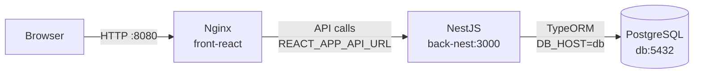

# 📰 NotiPoliWeb

Aplicación web tipo periódico digital desarrollada como proyecto del módulo **Desarrollo de Front-end**. Permite a los usuarios explorar noticias, guardar favoritos, publicar sus propias experiencias y gestionar su cuenta.

> **Arquitectura de 3 servicios Docker.**

---

## 📋 Descripción

**NotiPoliWeb** es una plataforma colaborativa donde los usuarios pueden:

- 📖 Explorar noticias clasificadas en cuatro categorías: **Educación, Tecnología, Turismo y Comercial**.
- ♥ Guardar noticias en favoritos (persistencia por usuario).
- ✍ Publicar sus propias noticias (Mini CRUD).
- 🗑 Eliminar únicamente las noticias que ellos mismos han creado.
- 👤 Registrarse, iniciar sesión y gestionar su cuenta.
- 📬 Contactar al equipo mediante un formulario validado.

---

## 🏗 Arquitectura de 3 Servicios (Separación del Monolito)

La aplicación se ha separado en **3 servicios independientes** contenerizados con Docker:

```
┌─────────────────────┐     ┌─────────────────────┐     ┌─────────────────────┐
│   front-react       │────▶│    back-nest        │────▶│    bd-postgres      │
│   (Nginx + React)   │     │    (NestJS + TS)    │     │    (PostgreSQL 15)  │
│   Puerto: 8080      │     │    Puerto: 3000     │     │    Puerto: 5432     │
└─────────────────────┘     └─────────────────────┘     └─────────────────────┘
        │                           │                           │
        ▼                           ▼                           ▼
   Servidor estático            API REST +                   Base de datos
   SPA (React Router)           TypeORM                      Persistente
```

| Servicio | Tecnología | Puerto | Descripción |
|----------|------------|--------|-------------|
| **front-react** | React 19 + Vite + Nginx | 8080 | Frontend SPA servido por Nginx |
| **back-nest** | NestJS + TypeORM | 3000 | API REST con validación y CORS |
| **bd-postgres** | PostgreSQL 15 | 5432 | Base de datos relacional |

---

## 🚀 Puesta en marcha

### Requisitos
- **Docker** y **Docker Compose** instalados
- Puertos libres: **8080**, **3000**, **5432**

---

### Opción A: Con Docker Compose Unificado (Recomendado - 1 comando)

Desde la raíz del proyecto (donde está `docker-compose.yml` y `.env`):

```bash
# 1. Crear .env desde plantilla (primera vez)
cp .env.example .env

# 2. Levantar los 3 servicios con healthchecks y red compartida
docker compose up -d
```

**Verificar que todo está corriendo:**
```bash
docker ps
# Deberías ver 3 contenedores: notipoli-db, notipoli-back, notipoli-front

# Ver estado de salud
docker compose ps
```

**URLs de acceso:**
- 🌐 **Frontend:** http://localhost:8080
- 🔧 **Backend API:** http://localhost:3000
- 🗄️ **Base de datos:** localhost:5432 (user/password, db: notipolibd)

> **Comunicación interna:** Los servicios se hablan por **nombre de servicio** en la red `notipoli-net`:
> - `front-react` → `back-nest:3000` (via `REACT_APP_API_URL=http://back-nest:3000`)
> - `back-nest` → `db:5432` (via `DB_HOST=db`)

---

### Opción B: Scripts de automatización (Windows PowerShell)

```powershell
# Levantar todo (BD → Back → Front con healthchecks)
.\start-notipoli.ps1

# Parar todo
.\stop-notipoli.ps1
```

---

### Opción C: Desarrollo local (sin Docker)

**Backend:**
```bash
cd back-nest
cp .env.example .env  # si existe, o crear .env con variables de BD
npm install
npm run start:dev     # http://localhost:3000
```

**Frontend:**
```bash
cd front-react
npm install
npm run dev           # http://localhost:5173 (proxy a backend en 3000)
```

**Base de datos:** Requiere PostgreSQL local corriendo en puerto 5432 con BD `notipolibd`, user `user`, pass `password`.

---

### Parar y limpiar

```bash
# Parar todos los servicios (compose unificado)
docker compose down

# Limpiar volúmenes (⚠️ borra datos de la BD)
docker compose down -v

# Opción legacy: parar compose individuales
# docker-compose -f front-react/docker-compose.yml down
# docker-compose -f back-nest/docker-compose.yml down
# docker-compose -f bd-postgres/docker-compose.yml down
```

---

## ⚙️ Variables de entorno

### Archivo `.env` en la raíz (para `docker-compose.yml` unificado)
```env
# Copia desde .env.example y ajusta si necesario
DB_USER=user
DB_PASS=password
DB_NAME=notipolibd
```

### back-nest/.env (para desarrollo local sin Docker)
```env
DB_HOST=localhost          # En Docker compose unificado usa 'db'
DB_PORT=5432
DB_USER=user
DB_PASS=password
DB_NAME=notipolibd
PORT=3000
```

### front-react/.env (para desarrollo local con Vite)
```env
REACT_APP_API_URL=http://localhost:3000   # En Docker compose unificado: http://back-nest:3000
```

### bd-postgres (docker-compose.yml individual)
```yaml
environment:
  POSTGRES_USER: user
  POSTGRES_PASSWORD: password
  POSTGRES_DB: notipolibd
```

> **Nota:** Cada servicio tiene su `.env.example` con valores de plantilla. Copia a `.env` y ajusta.

---

## 👤 Usuarios de prueba (seed automático)

Los datos semilla se cargan automáticamente la primera vez que el backend inicia:

| Correo | Contraseña |
|--------|------------|
| `juan@mail.com` | `123456` |
| `maria@mail.com` | `123456` |
| `carlos@mail.com` | `123456` |
| `ana@mail.com` | `123456` |

---

## 🛠 Tecnologías utilizadas

| Capa | Tecnología | Uso |
|------|------------|-----|
| **Frontend** | React 19 + TypeScript | Componentes y composición |
|  | Material UI (MUI) 9 | Sistema de componentes y theming |
|  | Vite 8 | Build y dev server |
|  | React Router 7 | Enrutado SPA |
|  | Vitest + Testing Library | Pruebas unitarias |
| **Backend** | NestJS 10 | Framework API REST |
|  | TypeORM + PostgreSQL | ORM y base de datos |
|  | class-validator | Validación de DTOs |
| **Infra** | Docker + Docker Compose | Contenerización y orquestación |
|  | Nginx (Alpine) | Servidor estático producción |
|  | PostgreSQL 15 | Base de datos relacional |

---

## 📁 Estructura del proyecto (3 servicios)

```
notipoli-web/
├── bd-postgres/                    # Servicio: Base de datos
│   ├── docker-compose.yml          # Orquestación PostgreSQL
│   └── data/                       # Volumen persistente (gitignored)
│
├── back-nest/                      # Servicio: Backend API
│   ├── src/
│   │   ├── main.ts                 # Bootstrap + CORS config
│   │   ├── app.module.ts           # Módulo raíz + TypeORM
│   │   ├── seed.ts                 # Seed automático al iniciar
│   │   ├── noticias/               # Módulo noticias (CRUD)
│   │   └── usuarios/               # Módulo usuarios (auth, favoritos)
│   ├── docker-compose.yml          # Orquestación backend
│   ├── Dockerfile                  # Build multi-stage
│   ├── .env                        # Variables de entorno
│   └── package.json
│
├── front-react/                    # Servicio: Frontend SPA
│   ├── src/
│   │   ├── components/             # UI reutilizable
│   │   ├── context/                # Estado global (Auth, Noticias, Notif)
│   │   ├── hooks/                  # Custom hooks
│   │   ├── pages/                  # Vistas por ruta
│   │   ├── services/               # Llamadas API (authService, etc.)
│   │   ├── utils/                  # Validaciones, fechas
│   │   └── main.tsx                # Entry point
│   ├── docker-compose.yml          # Orquestación frontend
│   ├── Dockerfile                  # Build multi-stage (Node → Nginx)
│   ├── nginx.conf                  # Config SPA routing
│   └── package.json
│
├── start-notipoli.ps1              # Script PowerShell: subir todo
├── stop-notipoli.ps1               # Script PowerShell: bajar todo
└── README.md
```

---

## 🌐 Comunicación entre servicios



- **Frontend → Backend:** `fetch()` a `http://back-nest:3000/...` (configurado en `REACT_APP_API_URL=http://back-nest:3000`)
- **Backend → BD:** TypeORM conecta a `db:5432` (nombre de servicio en red `notipoli-net`)
- **CORS:** Backend configurado para permitir `http://localhost:8080`
- **Red Docker:** Todos los servicios comparten la red `notipoli-net` (bridge)

---

## 🔁 Flujo de registro de usuario

1. Usuario completa formulario en `/registro` (front-react)
2. `TarjetaAuth` valida cliente → `authService.registrarUsuario()`
3. `POST /usuarios` → back-nest `UsuariosController.create()`
4. `UsuariosService.create()` → TypeORM `save()` → PostgreSQL
5. Respuesta 201 → Front crea sesión → Redirige a `/favoritos`

---

## 🧭 Rutas de la aplicación

| Ruta | Vista | Acceso |
|------|-------|--------|
| `/` | Inicio con noticias destacadas | Público |
| `/noticias` | Listado con filtros por categoría | Público |
| `/noticias/:id` | Detalle de una noticia + relacionadas | Público |
| `/favoritos` | Mis favoritos | Requiere sesión |
| `/gestionar-noticias` | Crear + listar mis noticias + comunidad | Requiere sesión |
| `/contacto` | Formulario de contacto | Público |
| `/acerca-de` | Información y estadísticas | Público |
| `/login` · `/registro` | Autenticación | Público |

---

## ✅ Pruebas

```bash
# Frontend
cd front-react && npm test

# Backend (si tiene tests)
cd back-nest && npm test
```

---

## 📦 Build de producción

```bash
# Frontend (genera dist/ para Nginx)
cd front-react && npm run build

# Backend (compila TypeScript)
cd back-nest && npm run build
```

---

## 👥 Autoría

Proyecto académico del módulo **Desarrollo de Front-end**.
Repositorio: https://github.com/Cronos186/NotiPoliWeb